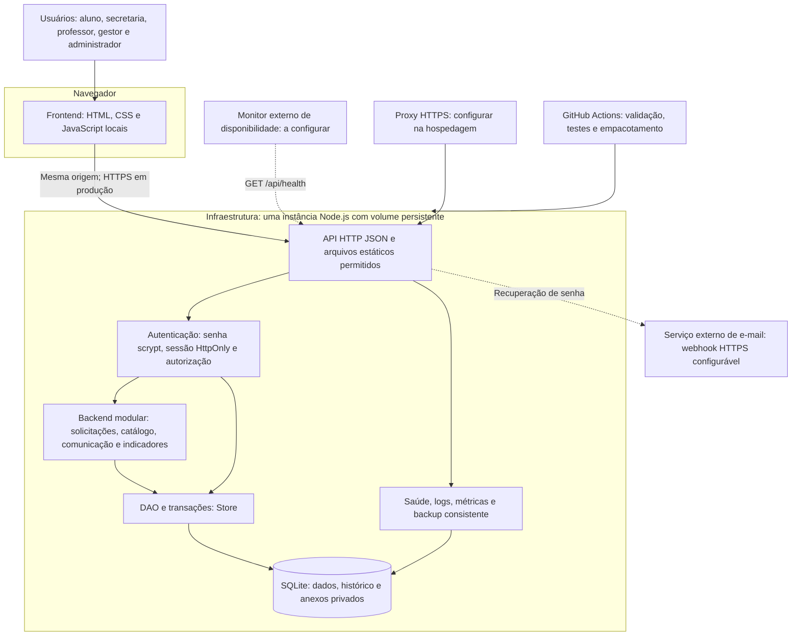

# Atividade 5 — Arquitetura técnica do SDASA

## Objetivo e contexto

O protótipo anterior executava no navegador e persistia em localStorage. A solução agora utiliza uma API com autenticação, autorização e banco relacional central. Mantém os fluxos definidos no Projeto Integrador e permite que aluno e secretaria utilizem sessões distintas.

Este documento responde à **Aula 05 MÓDULO 2 — Atividade 5**. A interpretação dos três tipos de caso de uso está em [CASOS_DE_USO.md](CASOS_DE_USO.md). O plano e o diagnóstico original estão em [../PLANEJAMENTO.md](../PLANEJAMENTO.md).

## Diagrama da arquitetura

Linhas pontilhadas indicam integrações externas dependentes de configuração. O workflow produz um pacote de aplicação; não faz implantação em um provedor sem destino configurado. Localmente, o servidor escuta em `127.0.0.1`, usando HTTP; em produção, um proxy deve terminar TLS e `PUBLIC_ORIGIN` deve apontar para a origem HTTPS real.

## Escolha e comparação

**1. Qual arquitetura?** Monólito modular, com MVC + DAO adaptado ao frontend separado por uma API HTTP.

**2. Por quê?** O escopo é um atendimento acadêmico integrado e a equipe precisa entregar fluxos consistentes antes de operar múltiplos serviços. Uma transação pode registrar pedido, protocolo, arquivos e histórico sem coordenação distribuída.

| Critério     | Monólito modular escolhido                     | Microsserviços                                 |
| ------------ | ---------------------------------------------- | ---------------------------------------------- |
| Implantação  | Um processo de aplicação                       | Vários processos e contratos entre serviços    |
| Consistência | Transações locais para o atendimento           | Exige coordenação entre limites de serviço     |
| Operação     | Logs, backup e diagnóstico centralizados       | Mais infraestrutura e rastreamento distribuído |
| Escala       | Escala conjunta, limitada pelo banco/instância | Escala independente por capacidade             |
| Evolução     | Módulos precisam preservar responsabilidades   | Contratos e versões precisam ser coordenados   |

**3. Vantagens:** execução local simples; transações atômicas; manutenção acessível; testes integrados rápidos; sem dependências de runtime externas ao Node.

**4. Desvantagens:** implantação conjunta; impacto compartilhado de falhas; SQLite e operações síncronas limitam concorrência; anexos em BLOB aumentam o banco; o limitador de requisições e as métricas são locais ao processo. Esta versão é dimensionada para uma instância e cargas pequenas, sem afirmação de capacidade medida.

**5. Como crescer?** Medir latência, memória, volume do banco e atrasos de atendimento. Adicionar paginação e índices conforme as consultas; migrar o DAO para um banco servidor quando a concorrência exigir; mover BLOBs para armazenamento privado de objetos e implementar verificação de arquivos; externalizar sessão, limitação e fila de e-mail antes de múltiplas instâncias. Extrair módulos para serviços somente quando houver benefício demonstrável.

## MVC + DAO e contratos

| Camada               | Implementação                                           | Responsabilidade                                                         |
| -------------------- | ------------------------------------------------------- | ------------------------------------------------------------------------ |
| View                 | `index.html`, `css/style.css`, `js/app.js`              | Formulários, consultas, foco e mensagens; sem autoridade para permissões |
| Controller/API       | `server/app.js`                                         | Rotas, sessão, origem das mutações, limites e respostas HTTP             |
| Model/Serviços       | `server/service.js`, `shared/core.js`, `server/auth.js` | Validações, fluxo, datas, autorização e credenciais                      |
| DAO                  | `server/database.js`                                    | Consultas parametrizadas, esquema e transações SQLite                    |
| Configuração inicial | `server/catalog.js`                                     | Catálogo inserido apenas quando ainda não existe                         |

As regras compartilhadas são importadas pelo frontend, backend e testes. A API repete as verificações de permissão mesmo quando a interface esconde um botão. Contratos detalhados: [API.md](API.md).

Entidades relacionais: `users`, `sessions`, `resets`, `services`, `requests`, `events`, `messages`, `attachments`, `notifications`, `settings` e `audit`. Dados do catálogo e snapshots da solicitação usam JSON, mantendo chaves relacionais para autoria, atribuição e anexos. Versão inicial do esquema: `PRAGMA user_version=1`; futuras alterações precisam de migração explícita e teste de restauração.

## Decisões de comportamento e segurança

- Aluno só acessa seus pedidos; professor só acessa demandas atribuídas e registra mensagens; secretaria/admin conduzem o atendimento; gestor acessa agregados.
- Cadastro público cria apenas alunos. O primeiro administrador é criado por script local, com segredo vindo de variável de ambiente. Alteração de perfil/inativação revoga sessões existentes e gera auditoria.
- Senha: mínimo de 12 caracteres, scrypt com salt aleatório. Sessão opaca armazenada por hash, cookie HttpOnly/SameSite=Strict, validade de oito horas e Secure em produção. Recuperação: hash de token de uso único, 30 minutos de validade, revogação das sessões ao redefinir.
- Mutações HTTP exigem Origin correspondente; recursos estáticos são servidos por lista permitida. CSP impede scripts inline, objetos e incorporação em frames. Conteúdo do usuário é escapado na interface.
- Arquivos: PDF/PNG/JPEG, assinatura inicial verificada, até 5 MB cada e 5 por operação; máximo de 20 anexos no pedido. Download sempre verifica o vínculo do usuário. Verificação de assinatura não equivale a antivírus; análise completa de malware é evolução para ambientes com documentos reais.
- Protocolo: sequência do banco + ano de São Paulo, restrição UNIQUE, criado junto com os eventos/anexos em transação. Duplo clique é bloqueado no frontend; reenvio independente de uma abertura ainda representa novo pedido.
- Alteração de status/atribuição exige a versão lida. Conflito retorna 409 e exige recarregar; não há sobrescrita silenciosa.
- Prazo: segunda a sexta, feriados cadastrados, vencimento às 18h de São Paulo. Complementação não pausa o prazo. Mudança de parâmetros só afeta novos pedidos.
- Encerrados são somente leitura, inclusive mensagens. Notificações são persistentes e atualizadas no navegador a cada 30 segundos; não há WebSocket nem promessa de entrega instantânea.
- Logs registram método, caminho, status, duração e correlação; não registram senha, corpo, cookie ou token de recuperação. Notificações não replicam o texto de documentos ou pareceres.

## Rastreabilidade

| Referência do documento integrador | Componente / entrega                                    | Verificação                                                   |
| ---------------------------------- | ------------------------------------------------------- | ------------------------------------------------------------- |
| RF01, RF02, RN02, RN03             | Cadastro, sessão, autorização e administração de perfis | Testes HTTP de credenciais, acesso cruzado e revogação        |
| RF03, RF11, RN01, RN04             | Abertura, documentos e protocolo transacional           | Fluxo no navegador; teste de rollback e unicidade             |
| RF04, RF05, RN05, RN06             | Consulta, máquina de estados e eventos                  | Testes de transição, estados finais e concorrência            |
| RF06, RN08                         | Notificações individuais                                | Teste de isolamento e leitura                                 |
| RF07, RN07                         | SLA, calendário e filtros                               | Testes de dias úteis/feriados/atraso                          |
| RF08, RN09                         | Conversa por solicitação                                | Fluxo entre aluno, secretaria e professor                     |
| RF09, RN10                         | Relatório agregado por período                          | Testes HTTP e tela do gestor                                  |
| RF10, RF12                         | Administração, encaminhamento e catálogo                | Testes de configuração e papel administrativo                 |
| RNF01                              | Responsividade, teclado, textos e erros                 | Teste de navegador; avaliação humana ainda a realizar         |
| RNF02                              | Autenticação, autorização e proteção de arquivos        | Testes negativos de API, headers e XSS no navegador           |
| RNF03                              | Saúde, logs e métricas                                  | Health check automatizado; monitor externo ainda a configurar |
| RNF04                              | Módulos, Git, testes e CI                               | Execução local e workflow; revisão humana no PR               |
