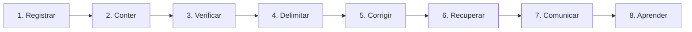

# Atividade 7 — Segurança da Informação e LGPD (Módulo 3)
## SDASA — Sistema Digital de Atendimento e Solicitações Acadêmicas

**Disciplina:** Tópicos Avançados em Sistemas de Informação II  
**Orientação:** Prof.ª Erika Miranda (Product Owner)  
**Ano:** 2026  
**Repositório Oficial:** [https://github.com/donald-cintado/SDASA](https://github.com/donald-cintado/SDASA)

---

## 👥 1. Equipe e Responsabilidades no Módulo 3

| Papel Scrum | Integrante | Responsabilidade em Segurança e LGPD |
|:---|:---|:---|
| **Product Owner** | **Prof.ª Erika Miranda** | Priorizar correções de segurança, decidir medidas de tratamento de dados e comunicações formais. |
| **Scrum Master** | **Donald Cintado Cabezas** | Facilitar o processo de resposta a incidentes e apoiar o time na remoção de impedimentos. |
| **Analista de Negócios** | **Ana Beatriz Cruz da Silva** | Avaliar impactos nos fluxos acadêmicos e garantir alinhamento com regras institucionais. |
| **Arquiteto de Software** | **Stephanny Crepalde Costa** | Revisar controles de sessão, autorização (RBAC), isolamento de dados e arquitetura técnica. |
| **Dev / DevOps** | **Júlio César Benício Inácio** | Aplicar correções no código, reforçar logs de auditoria, testes automatizados e controle de versões. |
| **Security Officer** | **Maria Luiza Dias Silva Tavares** | Coordenar análise de riscos, planos de resposta a incidentes, salvaguardas e conformidade LGPD. |
| **Qualidade e Sustentabilidade** | **Allan Vinícius Cabeggi Alvarenga** | Realizar testes de autorização, regressão, validação de integridade e teste de restauração de backups. |

---

## 🎯 2. Apresentação e Continuidade do Projeto

Esta atividade corresponde ao **Módulo 3** do Projeto Integrador SDASA e dá continuidade à definição do problema (Módulo 1), à especificação formal de requisitos (Módulo 2), à esteira DevOps e ao planejamento Scrum (Atividade 6). O objetivo central é preservar a **Confidencialidade**, **Integridade** e **Disponibilidade** (Tríade CID) das informações acadêmicas e pessoais tratadas pela plataforma.

### Entregável Oficial Solicitado:
1. **Matriz de Riscos de Segurança da Informação**;
2. **Plano de Segurança da Informação (Preventivo e Corretivo)**;
3. **Análise de Proteção de Dados (LGPD — Lei nº 13.709/2018)** aplicada ao cenário de incidente simulado informado pela coordenação.

---

## 🚨 3. Cenário: Investigação do Incidente de Acesso Não Autorizado

### 3.1 Relato do Incidente Simulado
> *"Um funcionário relata que uma pessoa não autorizada conseguiu acessar informações do SDASA."*

**Nota Metodológica:** Trata-se de um exercício de simulação acadêmica; não há evidências de incidente real em produção. O acesso não autorizado é a ocorrência reportada. Qualquer vazamento (cópia/divulgação), exfiltração de dados ou total de titulares afetados requer investigação pericial em logs e evidências antes de conclusões precipitadas.

### 3.2 Identificação dos Oito Elementos Exigidos

| Elemento | Análise Aplicada ao SDASA |
|:---|:---|
| **1. Ativo** | Banco de dados de usuários e solicitações (`sdasa.sqlite`), credenciais de acesso, registros de atendimento, anexos em storage protegido, logs de auditoria e sistema de autenticação. |
| **2. Ameaça** | Indivíduo não autorizado acessando, consultando, alterando ou copiando informações do sistema. |
| **3. Vulnerabilidade** | Hipóteses a investigar: credenciais comprometidas, senhas fracas, permissões excessivas, falha no controle de autorização (RBAC/IDOR) ou sessão web exposta. |
| **4. Risco** | Exposição, modificação indevida ou indisponibilidade de dados pessoais e registros acadêmicos devido a acesso não autorizado. |
| **5. Impacto** | Violação de privacidade de estudantes, fraudes, alterações indevidas de protocolos/pareceres, interrupção do atendimento escolar, perda de reputação e sanções legais da ANPD. |
| **6. Probabilidade** | **Alta** para o acesso indevido no cenário simulado relatado. Demais probabilidades são estimativas qualitativas de planejamento. |
| **7. Medida Preventiva** | Autorização estrita por perfil (RBAC), princípio do menor privilégio, senhas com KDF adaptativo (`scrypt`/Argon2) e salt, sessões com cookies seguros (`HttpOnly`, `SameSite=Strict`), TLS, auditoria ativa e testes automatizados. |
| **8. Medida Corretiva** | Revogar sessões ativas e credenciais comprometidas, isolar ambientes, preservar logs/evidências, corrigir vulnerabilidades no código, avaliar integridade dos dados e restabelecer o serviço de forma segura. |

### 3.3 Passos de Investigação e Resposta a Incidentes (8 Etapas)

1. **Registrar:** Anotar data/hora do relato, responsável pelo reporte, sistemas afetados e indícios iniciais, preservando a integridade dos registros sem deleções.
2. **Conter:** Suspender contas/sessões suspeitas imediatamente e limitar acessos, preservando a cadeia de custódia das evidências digitais.
3. **Verificar:** Analisar logs de autenticação, acessos aos endpoints de solicitações, mudanças de papéis e downloads de arquivos; distinguir tentativas de acessos consumados.
4. **Delimitar:** Mapear categorias de dados pessoais atingidos, período de exposição, funcionalidades envolvidas e titulares potencialmente afetados.
5. **Corrigir:** Tratar a causa raiz: redefinir credenciais, corrigir regras de autorização no código, ajustar permissões e aplicar atualizações de segurança.
6. **Recuperar:** Validar a integridade das tabelas do banco e dos arquivos, restaurar dados consistentes a partir de snapshots/backups íntegros quando necessário e reforçar monitoramento.
7. **Comunicar:** Acionar a gestão institucional para avaliação de risco ou dano relevante e cumprir as notificações obrigatórias à ANPD e aos titulares nos prazos legais.
8. **Aprender:** Conduzir lições aprendidas (Post-Mortem), documentar causas e incorporar novas medidas preventivas e testes automatizados nas próximas Sprints.

---

## 📊 4. Matriz de Riscos da Segurança da Informação

### Critério de Avaliação Didática Adotado
- **Probabilidade (P):** 1 = Baixa, 2 = Média, 3 = Alta.
- **Impacto (I):** 1 = Baixo, 2 = Médio, 3 = Alto.
- **Índice de Risco ($P \times I$):**
  - **1 a 2:** Baixo
  - **3 a 4:** Moderado
  - **6:** Alto
  - **9:** Crítico

### Tabela da Matriz de Riscos

| Risco | Probabilidade (P) | Impacto (I) | Índice ($P \times I$) | Classificação | Plano de Tratamento |
|:---|:---:|:---:|:---:|:---:|:---|
| **Acesso Indevido** | 3 (Alta) | 3 (Alto) | **9** | **Crítico** | **Tratar Imediatamente:** Bloquear acesso, revogar sessões suspeitas, analisar logs de requisições, revisar matriz RBAC e sanar falha. |
| **Senha Comprometida** | 3 (Alta) | 3 (Alto) | **9** | **Crítico** | **Reduzir:** Hash criptográfico adaptativo com salt (`scrypt`), rate limiting de tentativas, expiração de sessão e revogação imediata. |
| **Vazamento de Dados** | 2 (Média) | 3 (Alto) | **6** | **Alto** | **Reduzir:** Controle de acesso por perfil (RBAC), isolamento de dados por usuário, minimização de coleta e download restrito de anexos. |
| **Indisponibilidade** | 2 (Média) | 3 (Alto) | **6** | **Alto** | **Reduzir:** Backups versionados regulares, plano de contingência, reinício seguro e controle de carga com limites de payload. |
| **Perda de Dados** | 2 (Média) | 3 (Alto) | **6** | **Alto** | **Reduzir:** Rotina de backups protegidos com validação de integridade (`npm run backup`), testes de restauração sem sobrescrita e controle transacional no banco. |

**Ordem Prioritária de Tratamento:**
1. **Riscos Críticos (Nota 9):** Acesso Indevido e Senha Comprometida.
2. **Riscos Altos (Nota 6):** Vazamento de Dados, Indisponibilidade e Perda de Dados.

---

## 🛡️ 5. Plano de Segurança da Informação do SDASA

### 5.1 Medidas Preventivas e Implementação no Projeto

| Controle de Segurança | Implementação Técnica no SDASA | Relação com o Projeto |
|:---|:---|:---:|
| **Identificação e Autenticação** | Senhas com hash criptográfico `scrypt` com salt aleatório de 16 bytes e comparação por tempo constante (`timingSafeEqual`); rate limiting de 20 tentativas por IP em 15 min; tokens aleatórios de 256 bits (`crypto.randomBytes`). | RF01 / HU02 e HU13 |
| **Autorização por Perfil (RBAC)** | Validação no servidor (`canRead` e `canTransition` em `shared/core.js`): aluno só visualiza seus próprios pedidos e anexos; professor só atende demandas atribuídas; gestor acessa relatórios agregados sem dados nominais; secretaria despacha formalmente. | RF02, RF04 / HU05, HU09 e HU13 |
| **Proteção da Comunicação** | Sessões em cookies protegidos com `HttpOnly` (prevenção contra XSS), `SameSite=Strict` (prevenção contra CSRF), expiração automática (8 horas) e HTTPS/TLS mandatório em produção. | HU02 / Login e Comunicação |
| **Proteção de Dados e Anexos** | Princípio da minimização: CPF e telefone não coletados por padrão. Anexos armazenados em BLOB protegido com validação de tipo MIME e tamanho (até 5 MB), fora da raiz pública estática web. | Cadastro, HU04, HU14 e Anexos |
| **Monitoramento e Auditoria** | Tabela dedicada de `audit` no banco registrando autor, ação, alvo e timestamp UTC; timeline oficial em cada solicitação para rastreamento forense. | DevOps / RF05 |
| **Continuidade e Backup** | Backup consistente via snapshot SQLite e anexos integrados (`scripts/backup.js`); restauração com verificação de integridade e trava contra sobrescrita acidental (`scripts/restore.js`). | Banco de Dados / Operações |
| **Desenvolvimento Seguro** | Validação de entradas e schemas; lint estático; suíte automatizada de testes cobrindo permissões e falhas (`npm test`); verificação pré-commit de chaves e dados sensíveis (`scripts/security-check.js`). | Atividade 4 / DevOps / CI-CD |
| **Governança e Treinamento** | Definição clara de papéis e responsabilidades na equipe, matriz DoR/DoD com requisitos de segurança e inventário de dados tratados. | Security Officer / Instituição |

### 5.2 Medidas Corretivas
- Bloquear acessos suspeitos, revogar imediatamente as sessões ativas no banco (`DELETE FROM sessions WHERE user_id=?`) e forçar a redefinição de senhas.
- Preservar a integridade das tabelas de auditoria e logs antes de intervenções.
- Corrigir regras de autorização no código e validar com novos testes automatizados de regressão.
- Verificar integridade de protocolos, pareceres e arquivos através de hashes e timestamps; restaurar snapshots íntegros se constatada adulteração.
- Conduzir relatório formal de incidente de segurança.

---

## ⚖️ 6. Análise de Proteção de Dados (LGPD — Lei nº 13.709/2018)

Respostas fundamentadas às seis perguntas essenciais de conformidade:

### 6.1 Quais dados pessoais serão armazenados?
- **Dados cadastrais:** Nome completo, e-mail institucional/contato, matrícula acadêmica (RA), curso e perfil de acesso (`student`, `professor`, `secretary`, `manager`, `admin`).
- **Dados de atendimento:** Título do serviço solicitado, descrição da demanda, datas de abertura e atualização, status, número de protocolo e histórico de eventos.
- **Comunicações e arquivos:** Mensagens trocadas no chamado acadêmico e documentos anexados pelo titular (ex.: atestados, comprovantes, requerimentos).
- **Dados técnicos de segurança:** Registros de autenticação, data/hora de ações administrativas e tokens de sessão/redefinição (armazenados sob hash SHA-256).
- **Dados descartados/não coletados:** Senhas em texto puro **nunca** são armazenadas (apenas hashes `scrypt` com salt). CPF e telefone não são coletados por padrão no formulário de cadastro, em estrito respeito à minimização.

### 6.2 Quais dados são realmente necessários? (Minimização de Dados)

| Dado Pessoal | Necessidade Legítima / Justificativa de Minimização |
|:---|:---|
| **Nome e Matrícula (RA)** | Identificação do estudante e validação de vínculo acadêmico para emissão de documentos oficiais. |
| **E-mail Institucional** | Canal de autenticação segura, recuperação de conta e recebimento de notificações de tramitação. |
| **Perfil de Acesso** | Aplicação do controle de privilégios mínimos no sistema (RBAC). |
| **Tipo, Descrição e Protocolo** | Execução do serviço acadêmico solicitado e garantia de rastreabilidade formal. |
| **Documentos Anexos** | Apenas os estritamente exigidos pelo catálogo de serviços (evitando envio de documentos supérfluos). |
| **Logs Mínimos de Auditoria** | Cumprimento de obrigação legal e preservação da segurança da informação. |
| **CPF e Telefone** | **Não coletados por padrão:** dispensáveis para o fluxo rotineiro de autoatendimento da Sprint 1. |

### 6.3 Quem poderá acessar esses dados? (Controle de Acesso)

| Perfil | Escopo Permitido de Acesso |
|:---|:---|
| **Aluno** | Apenas seus próprios dados cadastrais, suas solicitações abertas, histórico e mensagens vinculadas aos seus protocolos. Não acessa dados de terceiros. |
| **Professor** | Somente dados e solicitações acadêmicas especificamente encaminhadas ou atribuídas a ele para emissão de parecer. |
| **Secretaria Acadêmica** | Dados operacionais e documentação necessária à triagem, instrução e despacho das solicitações sob gestão do setor. |
| **Gestor** | Acesso restrito a indicadores estatísticos e relatórios **agregados/anonimizados** de SLA e volumetria. **Sem acesso** a dados nominais individuais de alunos. |
| **Administrador** | Gestão técnica de parâmetros, catálogo e credenciais. Acesso a dados de conteúdo apenas sob estrita necessidade de manutenção com trilha de auditoria. |
| **Pessoa Não Autorizada** | **Nenhum acesso:** bloqueio por autenticação segura e rejeição imediata com código HTTP 401/403. |

### 6.4 Por quanto tempo deverão ser mantidos? (Temporalidade e Retenção)
- A instituição de ensino (controladora) deverá formalizar uma **Tabela de Temporalidade Documental**:
  - Dados cadastrais do aluno: mantidos durante a vigência do vínculo acadêmico e pelo período prescricional legal exigido pelo MEC/legislação educacional.
  - Solicitações e pareceres: mantidos pelo tempo regulamentar necessário à comprovação de vida acadêmica.
  - Logs de conexão e auditoria: conservados pelos prazos mínimos previstos no Marco Civil da Internet (art. 15) e políticas de segurança.
- **Regra Normativa Específica da ANPD:** Conforme a **Resolução CD/ANPD nº 15/2024**, os registros de incidentes de segurança da informação envolvendo dados pessoais devem ser mantidos pelo controlador por no mínimo **cinco anos**.

### 6.5 Como proteger os dados? (Salvaguardas Técnicas)
- Implementação de RBAC rigoroso no backend (`canRead`, `canTransition`).
- Armazenamento de senhas com KDF adaptativo (`scrypt`) e verificação em tempo constante.
- Isolamento dos arquivos anexos fora do diretório estático web público.
- Uso de sessões seguras em cookies `HttpOnly`, `SameSite=Strict` e HTTPS.
- Mecanismos de backup snapshot e testes de restauração para garantia de disponibilidade e integridade.
- Rate limiting contra ataques de força bruta e proteção de cabeçalho contra CSRF.

### 6.6 Como o usuário poderá exercer seus direitos? (Art. 18 da LGPD)
O titular poderá exercer seus direitos previstos no art. 18 da LGPD (confirmação da existência de tratamento, acesso aos dados, correção de dados incompletos/inexatos, anonimização, bloqueio ou eliminação) mediante solicitação ao Encarregado pelo Tratamento de Dados Pessoais (DPO) através de canal oficial institucional. O SDASA garante que os dados cadastrais e o histórico de solicitações estejam acessíveis ao estudante autenticado diretamente no seu painel.

### 6.7 Bases Legais Aplicáveis (Art. 7º e Art. 11 da LGPD)
O tratamento de dados no SDASA fundamenta-se primordialmente em:
1. **Execução de Contrato e Procedimentos Preliminares (Art. 7º, V):** Prestação de serviços educacionais e processamento de solicitações acadêmicas do estudante.
2. **Cumprimento de Obrigação Legal ou Regulatória (Art. 7º, II):** Atendimento a normas do Ministério da Educação (MEC) e arquivamento de registros escolares.
3. Não se deve fundamentar generalizadamente em "consentimento" operações rotineiras que constituem obrigação contratual ou legal da instituição de ensino.

---

## 📢 7. Comunicação de Incidentes de Segurança (Resolução CD/ANPD nº 15/2024)

Caso a investigação confirme incidente de segurança envolvendo dados pessoais com potencial de acarretar risco ou dano relevante aos titulares:
1. **Prazo de Notificação:** O controlador deverá comunicar a ANPD e os titulares em até **3 (três) dias úteis**, contados a partir do momento em que tomar conhecimento inequívoco de que o incidente afetou dados pessoais (Resolução CD/ANPD nº 15/2024).
2. **Conteúdo Obrigatório do Registro do Incidente:**
   - Natureza do incidente e dados pessoais afetados;
   - Número aproximado de titulares atingidos;
   - Medidas técnicas e de segurança adotadas para contenção e mitigação;
   - Riscos identificados e potenciais impactos aos titulares;
   - Identificação do Encarregado de Dados (DPO) e canais de contato.
3. O registro completo do incidente deve ser mantido arquivado pelo controlador por pelo menos **5 anos**.

---

## 🔗 8. Rastreabilidade com Engenharia de Software, Scrum e DevOps

| Item Anterior | Vínculo com a Atividade 7 | Evidência de Implementação no Código |
|:---|:---|:---|
| **HU02 — Login** | Autenticação segura, proteção de credenciais e gestão de sessões. | `server/auth.js` (`scrypt`, `verifyPassword`, rate limit). |
| **HU05 / HU06 — Consulta e Status** | Acesso restrito e confidencialidade de pedidos do aluno. | `server/service.js` (`canRead`, filtro `user_id = user.id`). |
| **HU09 / HU13 — Gestão e Permissões** | RBAC, menor privilégio e auditoria das ações administrativas. | `server/service.js` (`saveUser`, `audit()`, revogação de sessão). |
| **RF01 / RF02 — Autenticação e Autorização** | Validação mandatória no backend de permissões permitidas e negadas. | `tests/api.test.js` (testes de elevação de privilégio e IDOR). |
| **RF03 / RF05 — Registro e Histórico** | Integridade dos dados da solicitação e trilha de eventos. | Transações SQLite em `server/database.js` e histórico imutável. |
| **DevOps / CI-CD** | Validação automatizada contínua e proteção de segredos. | `npm test`, `scripts/security-check.js` e GitHub Actions. |
| **Próximas Sprints** | Implementação de MFA para perfis privilegiados e canal de DPO. | Registrado no plano de melhoria contínua da segurança. |

---

## 🏁 9. Conclusão da Revisão Técnica

O projeto SDASA cumpre com rigor os requisitos da **Atividade 7**:
- O incidente simulado foi abordado metodologicamente com distinção entre ocorrência e dano confirmado, cobrindo os **8 elementos** e os **8 passos de investigação**.
- A **Matriz de Riscos** prioriza tecnicamente as ameaças com índice $P \times I$ consistente.
- O **Plano de Segurança** apresenta controles preventivos e corretivos respaldados pela arquitetura já construída e testada.
- A **Análise LGPD** cobre integralmente as diretrizes de minimização, temporalidade, segregação de acessos (RBAC), bases legais (Art. 7º) e comunicação de incidentes conforme a **Resolução CD/ANPD nº 15/2024**.
- Todos os testes automatizados de segurança e controle de acesso executados localmente (`npm test`) foram validados com **100% de sucesso**.
