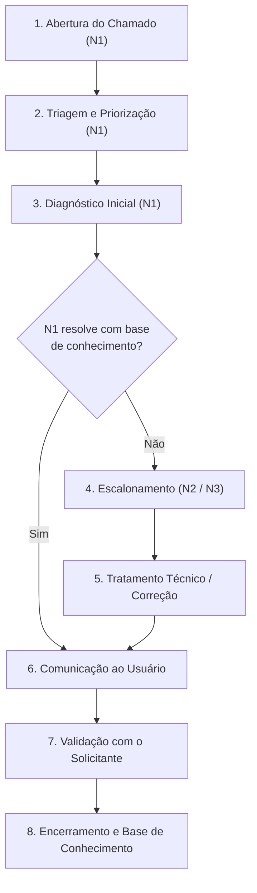

# Atividade 8 — ITIL: Central de Serviços (Módulo 3)
## SDASA — Sistema Digital de Atendimento e Solicitações Acadêmicas

**Disciplina:** Tópicos Avançados em Sistemas de Informação II  
**Orientação:** Prof.ª Erika Miranda (Product Owner)  
**Ano:** 2026  
**Repositório Oficial:** [https://github.com/donald-cintado/SDASA](https://github.com/donald-cintado/SDASA)

---

## 👥 1. Equipe e Responsabilidades no Módulo 3

| Integrante | Papel no Projeto | Papel na Central de Serviços / Simulação ITIL |
|:---|:---|:---|
| **Prof.ª Erika Miranda** | *Product Owner* | Homologação de SLAs, governança de serviços e alinhamento institucional. |
| **Donald Cintado Cabezas** | *Scrum Master* | **Service Desk (N1):** Abertura, triagem, categorização, priorização P1 e comunicação. |
| **Ana Beatriz Cruz da Silva** | *Analista de Negócios* | **Usuário Solicitante:** Reporte de incidente, descrição de impacto e validação final. |
| **Stephanny Crepalde Costa** | *Arquiteto de Software* | **Analista de Sistemas (N3):** Investigação de causa raiz no código/arquitetura e correção. |
| **Júlio César Benício Inácio** | *Dev / DevOps* | **Técnico de Infraestrutura (N2):** Diagnóstico de disponibilidade, análise de logs e restauração. |
| **Maria Luiza Dias Silva Tavares** | *Security Officer* | **Cliente Institucional:** Representante da faculdade, validação da retomada e segurança. |
| **Allan Vinícius Cabeggi Alvarenga** | *Qualidade e Sustentabilidade* | **Gestor de Incidentes:** Gestão de SLAs, autorização de escalonamento e comunicação de crise. |

---

## 🎯 2. Apresentação e Continuidade do SDASA

Esta atividade corresponde ao **Módulo 3** do Projeto Integrador SDASA e dá continuidade às fases anteriores:
- **Módulo 1:** Definição do problema e protótipo inicial de usabilidade.
- **Módulo 2:** Especificação formal de requisitos de software (RF, RNF, RN, Casos de Uso).
- **Atividade 6:** Abordagem Scrum, Product Backlog (HU01–HU15) e Sprint 1 (18 Story Points).
- **Atividade 7:** Segurança da Informação, Matriz de Riscos e conformidade LGPD.

### Contexto da Atividade 8:
O SDASA entrou em produção e passou a receber demandas de suporte técnico, operacionais e de serviços de alunos, docentes e colaboradores. Para estruturar o atendimento com alta qualidade, governança e previsibilidade, adota-se uma **Central de Serviços (Service Desk)** baseada nas melhores práticas do **ITIL 4** (*Service Desk, Incident Management e Service Request Management*).

---

## 📚 3. Catálogo de Serviços da Central de Serviços (TI / Suporte)

O catálogo de suporte complementa o catálogo de serviços acadêmicos (matrícula, histórico, justificativas) sem substituí-lo:

| Código | Serviço de Suporte | Escopo do Atendimento | Público-Alvo | Canal Previsto |
|:---:|:---|:---|:---|:---|
| **CS01** | **Acesso e Autenticação** | Login, recuperação de senha, desbloqueio de contas e problemas de credencial. | Aluno, professor, secretaria e gestor | Portal de Chamados / Service Desk |
| **CS02** | **Disponibilidade da Plataforma** | Quedas de servidor, erros HTTP 500, falhas gerais de conectividade ou indisponibilidade. | Todos os perfis | Portal, canal alternativo e telefone |
| **CS03** | **Desempenho** | Lentidão na abertura de telas, timeout em consultas ou atraso na gravação. | Todos os perfis | Portal de Chamados / Service Desk |
| **CS04** | **Perfis e Permissões** | Correção de papéis de acesso, permissões no painel da secretaria ou troca de perfil. | Usuários autorizados e gestores | Portal de Chamados / Service Desk |
| **CS05** | **Dados e Solicitações** | Inconsistências em numeração de protocolo, divergência de status ou dados truncados. | Aluno e secretaria | Portal de Chamados / Service Desk |
| **CS06** | **Orientação de Uso** | Dúvidas de navegação, formatos de anexos suportados e acompanhamento de prazos. | Aluno e professor | Base de Conhecimento / Service Desk |
| **CS07** | **Incidentes de Segurança** | Suspeita de invasão, tentativa de exfiltração de dados ou violação à LGPD. | Todos os perfis | Canal Prioritário de Segurança / DPO |

---

## ⚖️ 4. Regras de Classificação e Matriz de Prioridade

Todo chamado registrado na Central de Serviços deve conter: **ID único (CH-XXX), data/hora, solicitante, descrição, serviço afetado, categoria, impacto, urgência, prioridade, responsável, SLA aplicável, ações executadas e validação de encerramento**.

### 4.1 Conceitos Adotados
- **Categoria:**
  - *Incidente:* Interrupção não planejada ou redução da qualidade de um serviço.
  - *Requisição de Serviço:* Solicitação rotineira de serviço ou informação (ex.: redefinição de senha).
- **Impacto:** Alto (toda a instituição / serviço essencial fora), Médio (departamento ou grupo de usuários), Baixo (usuário único ou caso isolado).
- **Urgência:** Alta (processo acadêmico crítico paralisado sem plano de contorno), Média (operação degradada mas com alternativa parcial), Baixa (há contorno simples ou tarefa não urgente).

### 4.2 Matriz de Prioridade ITIL

| Urgência \ Impacto | Alto Impacto | Médio Impacto | Baixo Impacto |
|:---|:---:|:---:|:---:|
| **Alta Urgência** | **P1 — Crítica** | **P2 — Alta** | **P3 — Média** |
| **Média Urgência** | **P2 — Alta** | **P3 — Média** | **P4 — Baixa** |
| **Baixa Urgência** | **P3 — Média** | **P4 — Baixa** | **P4 — Baixa** |

### 4.3 Níveis de Escalonamento
- **N1 — Service Desk:** Atendimento inicial, registro, triagem, diagnósticos rápidos e soluções via Base de Conhecimento.
- **N2 — Suporte Especializado / Infraestrutura:** Análise técnica avançada de ambiente, logs, conectividade e banco de dados.
- **N3 — Engenharia de Software / DevOps / Segurança:** Correção de bugs de código, falhas de arquitetura e incidentes graves de segurança.
- **Gestão:** Coordenação de crises, aprovação de mudanças emergenciais e comunicação institucional.

---

## 🎫 5. Análise dos Cinco Chamados do Cenário Simulado

### 🔹 CH-001 • Sistema Indisponível (Cenário da Simulação Prática)
- **Categoria:** Incidente / Disponibilidade (CS02)
- **Prioridade:** **P1 — Crítica** (Impacto Alto + Urgência Alta)
- **Responsável:** N2 Infraestrutura / DevOps (N1 faz registro e despacho imediato)
- **SLA Proposto:** Tempo de Resposta: até **15 minutos** | Restauração: até **4 horas corridas** (cobertura 24×7)
- **Escalonamento:** N1 $\rightarrow$ N2 imediatamente; N3 e Gestor acionados se persistir por mais de 30 minutos.
- **Solução / Procedimento:** Verificar integridade do processo Node.js e logs do servidor; testar endpoint `/api/health`; se constatada falha irrecuperável, executar restauração a quente via script [`scripts/restore.js`](file:///c:/Users/user/Desktop/FaculdadeADS/PROJETOS/SDASA/scripts/restore.js) com snapshot SQLite validado; revalidar conectividade e monitorar.

### 🔹 CH-002 • Usuário Esqueceu a Senha
- **Categoria:** Requisição de Serviço / Acesso (CS01)
- **Prioridade:** **P4 — Baixa** (Impacto Baixo + Urgência Baixa)
- **Responsável:** N1 Service Desk
- **SLA Proposto:** Tempo de Resposta: até **4 horas úteis** | Atendimento: até **1 dia útil**
- **Escalonamento:** N1 $\rightarrow$ N2 Segurança apenas em caso de inconsistência cadastral ou suspeita de engenharia social.
- **Solução / Procedimento:** Orientar o usuário a utilizar a rota de autoatendimento seguro `/api/auth/forgot` (token temporário com hash SHA-256 no banco e link de 30 minutos); jamais solicitar ou fornecer senha em texto claro.

### 🔹 CH-003 • Sistema Apresenta Lentidão
- **Categoria:** Incidente / Desempenho (CS03)
- **Prioridade:** **P2 — Alta** (Impacto Médio + Urgência Alta)
- **Responsável:** N2 Técnico / Infraestrutura
- **SLA Proposto:** Tempo de Resposta: até **30 minutos** | Restauração: até **8 horas úteis**
- **Escalonamento:** N1 $\rightarrow$ N2; N3 se o gargalo for de consultas não otimizadas no banco relacional; Gestor se atingir 75% do prazo.
- **Solução / Procedimento:** Inspecionar métricas internas de requisições e latência (`metrics.totalMs`), uso de CPU/RAM da máquina hospedeira e tamanho da base de dados; ajustar limites de payload e reverter eventual deploy recente.

### 🔹 CH-004 • Não Acessa uma Funcionalidade
- **Categoria:** Incidente / Acesso e Permissão (CS04)
- **Prioridade:** **P3 — Média** (Impacto Baixo + Urgência Média)
- **Responsável:** N1 Service Desk + N2 Aplicação
- **SLA Proposto:** Tempo de Resposta: até **2 horas úteis** | Resolução: até **2 dias úteis**
- **Escalonamento:** N1 $\rightarrow$ N2 para checar papéis; N3 / Security se houver bug na matriz RBAC.
- **Solução / Procedimento:** Reproduzir o erro com o perfil informado; verificar na tabela `users` se o papel atribuído (`role`) é condizente com a função acadêmica; se necessário, o administrador atualiza o papel via `/api/users/:id` registrando na tabela `audit`.

### 🔹 CH-005 • Dados Apresentados Incorretos
- **Categoria:** Incidente / Integridade de Dados (CS05)
- **Prioridade:** **P2 — Alta** (Impacto Médio + Urgência Alta)
- **Responsável:** N2 Analista de Sistemas + Secretaria
- **SLA Proposto:** Tempo de Resposta: até **30 minutos** | Resolução: até **8 horas úteis**
- **Escalonamento:** N1 $\rightarrow$ N2 Analista; N3 Banco de Dados e Security Officer se houver suspeita de manipulação externa indevida.
- **Solução / Procedimento:** Confrontar o registro da tabela `requests` com a trilha de auditoria em `events` e `audit`; identificar se houve falha de concorrência ou formatação; corrigir o registro via transação protegida e revalidar com o solicitante.

---

## ⏱️ 6. Tabela de SLAs Proposta (Service Level Agreements)

| Prioridade | Meta de Resposta (MTTA) | Meta de Resolução (MTTR) | Janela de Medição | Política de Alerta e Escalonamento |
|:---|:---:|:---:|:---:|:---|
| **P1 • Crítica** | **15 minutos** | **4 horas corridas** | **24 × 7** (Indisponibilidade / Crise) | Gestor avisado imediatamente; reavaliação a cada 30 min com N2/N3. |
| **P2 • Alta** | **30 minutos** | **8 horas úteis** | Seg–Sex, 08h–18h | N2 acionado na triagem; Gestor acionado se atingir 75% do tempo. |
| **P3 • Média** | **2 horas úteis** | **2 dias úteis** | Seg–Sex, 08h–18h | N2 acionado após triagem ou se decorrido 50% do prazo sem progresso. |
| **P4 • Baixa** | **4 horas úteis** | **1 dia útil** | Seg–Sex, 08h–18h | N2 acionado se N1 não conseguir resolver ou identificar suspeita de segurança. |

---

## 🔄 7. Fluxo Operacional de Atendimento (8 Etapas ITIL)

---

## 🎭 8. Roteiro da Simulação Prática (15 Minutos / 6 Integrantes)

**Cenário Escolhido:** **CH-001** (Indisponibilidade Geral do SDASA — Incidente P1 Crítico)

| Janela de Tempo | Participante | Papel Simulado | Ação / Fala Orientadora no Exercício |
|:---:|:---|:---|:---|
| **00:00 – 02:00** | **Ana Beatriz** | Usuária Solicitante | Reporta falha total: alunos não conseguem acessar o portal de solicitações às vésperas do encerramento de prazos. Descreve mensagem de erro e urgência. |
| **02:00 – 04:00** | **Donald Cintado** | Service Desk (N1) | Abre ticket oficial **CH-001**, categoriza como Incidente de Disponibilidade, define severidade **P1 (Crítica)**, informa SLA de resposta de 15 min e escala imediatamente para N2. |
| **04:00 – 07:00** | **Júlio César** | Técnico Infra (N2) | Inspeciona logs do servidor Node.js e integridade do banco `sdasa.sqlite`. Identifica corrupção de processo e propõe restauração consistente via snapshot de backup. |
| **07:00 – 10:00** | **Stephanny Crepalde** | Analista / Dev (N3) | Valida a causa raiz na aplicação, executa script seguro de restauração em ambiente controlado, sobe o serviço e roda bateria de testes de integridade (`npm test`). |
| **10:00 – 12:00** | **Allan Vinícius** | Gestor de Incidentes | Monitora o relógio de SLA (dentro do limite de 4h corridas), aprova o plano de comunicação de contingência e autoriza a reabertura do tráfego aos usuários. |
| **12:00 – 14:00** | **Maria Luiza** | Cliente Institucional | Efetua teste de homologação no portal, valida que as solicitações acadêmicas e anexos foram preservados integralmente e aprova formalmente a resolução. |
| **14:00 – 15:00** | **Donald Cintado** | Service Desk (N1) | Registra o procedimento no ticket, colhe o aceite da cliente, encerra formalmente o chamado **CH-001** e publica artigo na Base de Conhecimento para prevenção de recorrência. |

---

## 🔗 9. Rastreabilidade com Scrum, DevOps e Segurança/LGPD

| Origem do Chamado | Vínculo com Atividades Anteriores | Implementação no Projeto SDASA |
|:---|:---|:---|
| **Queda ou Indisponibilidade (CH-001 / CS02)** | **DevOps:** Testes, scripts de backup/restore e logs | Scripts [`scripts/backup.js`](file:///c:/Users/user/Desktop/FaculdadeADS/PROJETOS/SDASA/scripts/backup.js) e [`scripts/restore.js`](file:///c:/Users/user/Desktop/FaculdadeADS/PROJETOS/SDASA/scripts/restore.js). |
| **Esquecimento de Senha (CH-002 / CS01)** | **Segurança / LGPD (Ativ. 7):** Proteção de credenciais | Rota `/api/auth/forgot` com hash SHA-256 e expiração de 30 min sem expor senhas. |
| **Lentidão / Gargalo (CH-003 / CS03)** | **DevOps / Requisitos:** Métricas de desempenho e SLA | Monitoramento de latência em [`server/app.js`](file:///c:/Users/user/Desktop/FaculdadeADS/PROJETOS/SDASA/server/app.js) e cálculo de dias úteis em [`shared/core.js`](file:///c:/Users/user/Desktop/FaculdadeADS/PROJETOS/SDASA/shared/core.js). |
| **Falha de Autorização (CH-004 / CS04)** | **Engenharia de Software:** RF02 / Matriz RBAC | Funções [`canRead`](file:///c:/Users/user/Desktop/FaculdadeADS/PROJETOS/SDASA/shared/core.js#L63-L70) e [`canTransition`](file:///c:/Users/user/Desktop/FaculdadeADS/PROJETOS/SDASA/shared/core.js#L71-L80) com testes automatizados. |
| **Divergência de Dados (CH-005 / CS05)** | **Módulo 2 & Atividade 7:** Integridade e auditoria | Tabela `audit`, histórico `events` e versionamento otimista de concorrência. |
| **Demandas Recorrentes de Usuários** | **Scrum (Atividade 6):** Melhoria contínua | Incidentes reincidentes convertem-se em itens priorizados do Product Backlog da Sprint. |

---

## 📈 10. Indicadores de Desempenho da Central de Serviços (KPIs)

1. **Cumprimento de SLA (%):** Percentual de tickets resolvidos dentro do prazo acordado (meta $\ge 95\%$).
2. **MTTA (Mean Time to Acknowledge):** Tempo médio decorrido até o primeiro contato/resposta da equipe de suporte.
3. **MTTR (Mean Time to Resolve):** Tempo médio total até a efetiva restauração e resolução do chamado.
4. **FCR (First Contact Resolution):** Taxa de chamados resolvidos no primeiro nível (N1) sem necessidade de escalonamento.
5. **CSAT (Customer Satisfaction Score):** Nível de satisfação do usuário registrado após o fechamento do chamado.
