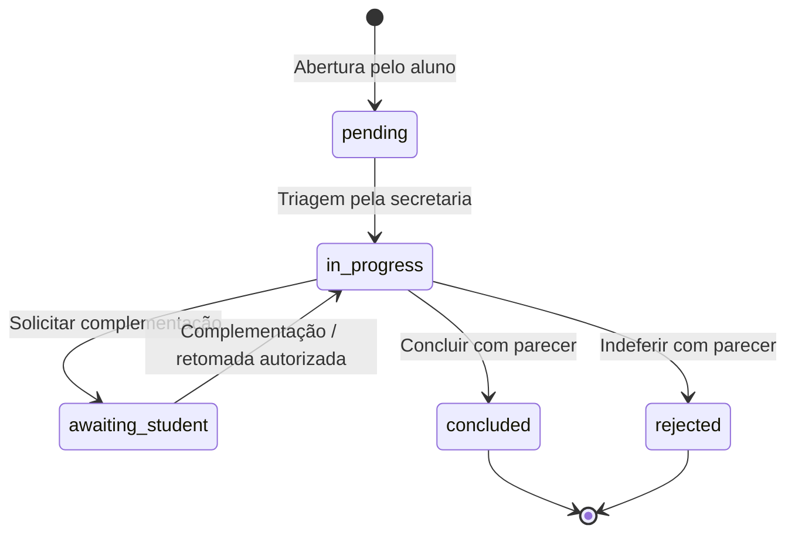

# Atividade 5 — Casos de uso

O material da atividade pede um caso de configuração, um de análise e um de condução, sem definir essas categorias. O enquadramento abaixo aplica-as ao domínio do SDASA. Os identificadores `UC-A5-*` complementam e não renumeram UC01–UC06 do documento integrador.

## UC-A5-01 — Configurar serviço acadêmico (configuração)

**Ator:** administrador. **Relação:** RF12, parametrização administrativa descrita na seção 2.1 do documento integrador; RN04/RN07. **Pré-condição:** administrador autenticado e ativo.

Fluxo principal:

1. Acessar Administração e selecionar criação ou edição de serviço.
2. Informar título, categoria, descrição, prazo de 1–365 dias úteis e documentos necessários.
3. Definir se um anexo é obrigatório e se o serviço está ativo.
4. Confirmar; o servidor valida papel e dados, persiste a configuração e registra auditoria na mesma transação.
5. O catálogo de abertura passa a apresentar o serviço ativo e suas condições.

Alternativas: dados inválidos mantêm o formulário com erro; serviço inativo deixa de aceitar novas aberturas; perfil sem permissão recebe 403; falha de gravação não confirma sucesso. O calendário de feriados é configurado separadamente, com datas válidas no formato AAAA-MM-DD.

**Pós-condição:** novos pedidos utilizam a configuração salva. Pedidos existentes preservam título, categoria e prazo registrados na abertura.

**Aceite:** configurar um serviço como administrador, abri-lo como aluno, verificar SLA e anexo obrigatório; inativá-lo e confirmar rejeição de novas aberturas pela API.

## UC-A5-02 — Analisar solicitação (análise)

**Ator principal:** secretaria. **Participante:** professor atribuído. **Relação:** UC04, RF04/RF05/RF07/RF10, RN03/RN05/RN06/RN07. **Pré-condição:** solicitação em triagem; secretaria autenticada.

Fluxo principal:

1. Localizar a demanda por protocolo, serviço, aluno, status ou atraso.
2. Consultar descrição, prazo, documentos e histórico.
3. Registrar parecer de triagem e mover de `pending` para `in_progress`.
4. Quando necessário, atribuir um professor ou funcionário responsável.
5. O professor atribuído consulta os dados e envia seu parecer na conversa.
6. A secretaria decide entre continuar o atendimento, solicitar complementação, concluir ou indeferir.

Alternativas: documentos insuficientes levam a `awaiting_student` com justificativa; usuário sem vínculo recebe 404 ao consultar pedido/arquivo; alteração concorrente retorna 409, exigindo atualização dos detalhes. Professor não conclui nem altera o status por conta própria.

**Pós-condição:** análise registrada, situação identificável e participantes notificados quando aplicável. Não há edição silenciosa nem exclusão dos eventos anteriores.

**Aceite:** professor não atribuído não acessa; após atribuição, visualiza e comenta; secretaria registra parecer e o aluno visualiza o evento correspondente.

## UC-A5-03 — Conduzir atendimento até encerramento (condução)

**Ator principal:** secretaria. **Participantes:** aluno e professor atribuído. **Relação:** UC03/UC04/UC05, RF05/RF06/RF07/RF08/RF10, RN05/RN06/RN08/RN09. **Pré-condição:** pedido em análise e participantes autorizados.

Fluxo principal:

1. A secretaria acompanha pendências e prazo, mantendo a comunicação no protocolo.
2. Se faltar informação, registra justificativa e altera para `awaiting_student`.
3. O aluno consulta a notificação, informa a complementação e pode anexar documentos.
4. O sistema registra a resposta e devolve o pedido para `in_progress`.
5. A secretaria conclui (`concluded`) ou indefere (`rejected`), sempre com parecer.
6. O sistema registra ator, data, status, encerramento e notificações em uma transação.
7. O aluno consulta o resultado e pode imprimir o comprovante de envio. O gestor acompanha os agregados de atendimento.

Alternativas: transição inexistente retorna 403; versão desatualizada retorna 409; anexo inválido interrompe a operação antes de salvar; falha de gravação desfaz a operação completa. Encerrados não aceitam novas mensagens ou reabertura nesta versão.

**Pós-condição:** resultado rastreável, histórico preservado, notificações individualizadas e dados disponíveis para indicadores.

**Aceite:** demonstrar todo o ciclo em sessões independentes, incluindo complementação, erro de transição, notificação e consulta após reiniciar o servidor.

## Estados implementados

Secretaria e administrador executam as transições previstas. O aluno executa apenas a complementação de seu pedido. Professor participa pela conversa. Gestor não participa da tramitação.
